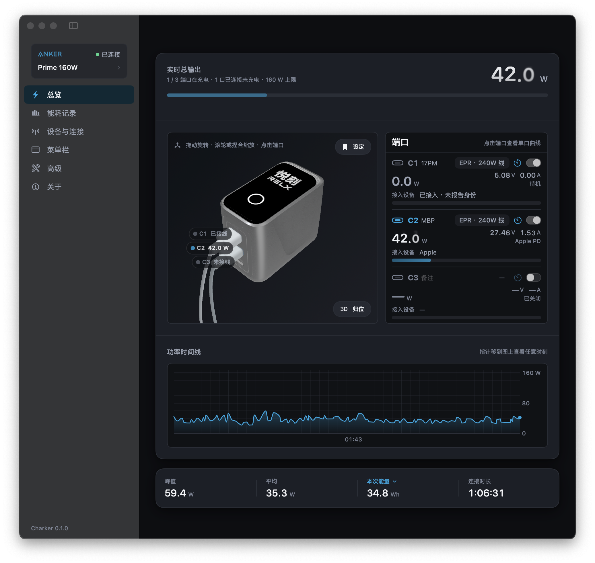

<div align="center">
  
  <h1>Charker</h1>
  <p><strong>在 Mac 上查看和控制 Anker Prime 160W 与 250W。</strong></p>
  <p>简体中文 · <a href="README_EN.md">English</a></p>
  <p>
    <a href="https://github.com/qzz0518/Charker/stargazers"></a>
    
    
    <a href="LICENSE"></a>
    <a href="https://x.com/zerah_eth"></a>
  </p>
</div>

<p align="center">
  
</p>

Charker 是 **Anker Prime 160W（A2687）** 和 **Anker Prime Charger 250W（A2345）** 的非官方 macOS 应用。160W 通过蓝牙直连，250W 用 Anker 账号经 Wi-Fi 云端连接。

> [!IMPORTANT]
> Charker 是独立项目，与 Anker 无关联、未获其背书。读数已在 160W（蓝牙固件 `v0.0.5.2`）和 250W（固件 `2.1.1.6`）上实机验证。控制功能中，160W 的屏幕设置和 250W 的端口开关已实机验证，其余尚未实机验证。

## 功能

- **实时总览**：各端口的电压、电流和功率，3D 设备模型，功率曲线。
- **菜单栏**：不开主窗口也能看总功率或单口功率，显示内容可以自定义。
- **能耗与电费**：按天、周、月查看用电量和电费，可导出 CSV / JSON。
- **设备控制**
  - 160W：端口开关与倒计时，屏幕语言、亮度、自动锁屏和方向，固定分配，自定义充电模式。
  - 250W：端口开关、倒计时与定时，充电模式与优先端口，自定义充电模式，屏幕、时钟屏保与主题，实验室开关。
- **Apple 家庭**：把各端口接入「家庭」App，查看功率（需要 iOS 27）、开关端口。
- **模拟充电器**：没有设备也能体验界面，模拟数据不会进入真实记录。
- **中英双语**，应用内更新。

## 安装

需要 macOS 14 或更高版本。

```bash
brew install --cask qzz0518/tap/charker
```

或者从 [Releases](https://github.com/qzz0518/Charker/releases) 下载 DMG，拖进「应用程序」。

## 连接

**160W（蓝牙）**：先完全退出手机上的 Anker App（160W 同时只能连一台设备，被占用时可能搜不到），再在「设备与连接」里选择充电器；如有提示，填入 Anker 账号 ID。

**250W（Wi-Fi）**：先在 Anker App 里绑定并配网，再在「设备与连接」里用同一个 Anker 账号登录。日本账号选 JP，中国大陆账号用手机验证码登录。

两种型号控制端口前，都要先在「高级」里打开「允许端口开关」。

**Apple 家庭**：在「Apple 家庭」页打开「接入 Apple 家庭」，用 iPhone「家庭」App 扫二维码添加，提示未认证配件时选「仍然添加」。整台充电器（显示总功率）和每个端口各有一个二维码；两个都添加的话，「电力」里的全屋功率会把这台充电器算两遍。Mac 睡眠或 Charker 退出后，「家庭」里会显示「无响应」。同一时间只有 Charker 当前选中的充电器会在「家庭」里更新。

## 隐私

- 160W 的数据走本机蓝牙；250W 的数据和控制经 Anker 云端加密传输。
- 「接入 Apple 家庭」默认关闭。打开后，端口开关和功率经本地网络加密发给你的「家庭」。
- 能耗历史和设置只存在这台 Mac 上。没有 Charker 服务器，也不收集使用数据。
- 不保存密码和验证码。250W 的登录令牌存在钥匙串里，退出登录即删除，官方 App 里的绑定不受影响。
- 250W 的自定义充电模式、实验室开关和上传的时钟图片会写入 Anker 账号，和官方 App 一样。

## 从源码构建

需要 Xcode Command Line Tools、Swift 6.0+、rustup、mise 和 ripgrep：

```bash
git clone https://github.com/qzz0518/Charker.git
cd Charker
mise run verify        # 构建、测试并打包 dist/Charker.app
open dist/Charker.app
```

测试真实蓝牙要用打包后的 `.app`，`mise run run` 只适合界面和模拟模式。

## 参与贡献

欢迎提 [Issue](https://github.com/qzz0518/Charker/issues) 和 PR。涉及设备行为的，请写明型号、固件版本和复现步骤，不要上传账号 ID、序列号、蓝牙地址或原始抓包。

## 致谢与许可证

协议参考了 [SolixBLE](https://github.com/flip-dots/SolixBLE)、[Anker_Prime_160W_WebBLE](https://github.com/Hyper-Beast/Anker_Prime_160W_WebBLE)、[Anker_Prime_BLE_hacking](https://github.com/atc1441/Anker_Prime_BLE_hacking) 和 [anker-solix-api](https://github.com/thomluther/anker-solix-api)，Charker 的实现为独立编写。

代码以 [MIT License](LICENSE) 发布。Anker 商标、产品图片、3D 模型等第三方素材不在 MIT 许可范围内，详见 [`THIRD-PARTY-NOTICES.md`](THIRD-PARTY-NOTICES.md)。
